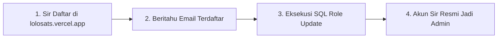

# 🚀 PANDUAN PELUNCURAN KOMERSIAL: LOLOSATS (LAUNCH PLAYBOOK)

> **Platform Publik:** [https://lolosats.vercel.app](https://lolosats.vercel.app)  
> **Backend Remote:** Supabase `lolosats-prod` (`uxiqklvnjtgscaulutld`)  
> **Arsitektur:** Vite + Vanilla JS + Supabase (PostgreSQL 17 + RLS + Deno Edge Functions)  
> **Lisensi Sistem:** Kriptografis SHA-256 One-Way Hash (`LA-XXXXX`)  
> **Target Pengguna:** Mahasiswa, Fresh Graduate, & Profesional Pencari Kerja di Indonesia  

---

## 1. RINGKASAN STRATEGI BISNIS & NILAI PRODUK

LolosATS dirancang sebagai solusi cepat, terjangkau, dan ramah privasi untuk pelamar kerja di Indonesia:
1. **ATS Compatibility Engine:** Memeriksa resume terhadap kata kunci lowongan dan format yang ramah mesin ATS perusahaan multinasional maupun BUMN.
2. **Generator Surat Lamaran:** Menulis draf surat lamaran formal secara instan berdasarkan kualifikasi lowongan.
3. **Ekspor Ganda (DOCX & PDF):** Menghasilkan dokumen Word biner valid (OpenXML ECMA-376) yang mudah diedit lebih lanjut, serta file PDF vektor tajam via browser print.
4. **Isolasi Privasi & Cloud Sync:** Data tersimpan lokal di peramban secara default dan dapat disinkronkan ke cloud dengan enkripsi isolasi Row Level Security (RLS).

---

## 2. PANDUAN AKTIVASI CUSTOM SMTP (RESEND — 100% GRATIS)

Untuk menghindari batas pengiriman email bawaan Supabase (3–4 email/jam) dan memastikan konfirmasi email serta reset password berjalan profesional:

### Langkah A: Buat Akun & API Key di Resend
1. Kunjungi [resend.com](https://resend.com) dan buat akun gratis (kuota 3.000 email/bulan, 100 email/hari gratis tanpa kartu kredit).
2. Di dashboard Resend, buka menu **API Keys** -> Klik **Create API Key**.
3. Beri nama (misal: `lolosats-supabase`) dan salin API Key (`re_xxxxxxxxxxxx`).

### Langkah B: Konfigurasi di Supabase Dashboard
1. Buka Dashboard Supabase: `https://supabase.com/dashboard/project/uxiqklvnjtgscaulutld`.
2. Buka menu **Authentication** -> **SMTP Settings** (di bawah Settings).
3. Aktifkan sakelar **"Enable Custom SMTP"**.
4. Masukkan parameter berikut:
   - **Sender Email:** `onboarding@resend.dev` (atau domain kustom jika Sir memiliki domain sendiri)
   - **Sender Name:** `LolosATS Support`
   - **Host:** `smtp.resend.com`
   - **Port:** `465` (SSL) atau `587` (TLS)
   - **Username:** `resend`
   - **Password:** Masukkan API Key Resend (`re_xxxxxxxxxxxx`)
5. Klik **Save Changes**.

*Setelah langkah ini selesai, seluruh pendaftaran akun baru dan permintaan lupa kata sandi akan terkirim instan tanpa antrean kuota.*

---

## 3. PANDUAN AKTIVASI AKUN ADMIN RESMI SIR

Database produksi saat ini dalam kondisi **bersih (0 data uji)**. Untuk mengangkat akun Sir menjadi Admin resmi berwenang:



### Langkah Eksekusi:
1. Sir mendaftar langsung di [https://lolosats.vercel.app](https://lolosats.vercel.app) menggunakan email pribadi Sir.
2. Setelah mendaftar, beri tahu saya email tersebut.
3. Saya (atau Sir di SQL Editor Supabase) akan mengeksekusi query aman berikut:
   ```sql
   UPDATE public.profiles 
   SET role = 'admin' 
   WHERE id = (SELECT id FROM auth.users WHERE email = '<EMAIL_RESMI_SIR>');
   ```
4. Verifikasi instan:
   ```sql
   SELECT id, display_name, role FROM public.profiles WHERE role = 'admin';
   ```

---

## 4. ALUR KERJA PENCETAKAN & PENJUALAN LISENSI (OPERATIONAL WORKFLOW)

Sistem LolosATS menggunakan kode alfanumerik `LA-XXXXXXXXXXXXXXXXXXXXXXXXXXXXXXXXXXXX` (36 karakter hex) yang di-hash menggunakan SHA-256 di database:

```
[Sir / Admin] ──(Buat Lisensi)──> Dapat Kode: LA-A7EFD9... ──> Berikan ke Pembeli
                                                                       │
                                                       (Pembeli Masukkan di App)
                                                                       │
                                                                       ▼
                                                       [Status Lisensi: AKTIF]
```

### A. Cara Membuat Lisensi Baru
Sir dapat meminta saya untuk membuat batch lisensi kapan saja, atau memanggil Edge Function `admin-license` menggunakan token login admin Sir:
- **Lisensi 30 Hari (Paket Mahasiswa):**
  `POST /functions/v1/admin-license` dengan body `{"action": "create", "days": 30}`
- **Lisensi 365 Hari (Paket 1 Tahun):**
  `POST /functions/v1/admin-license` dengan body `{"action": "create", "days": 365}`
- **Lisensi Seumur Hidup (Lifetime):**
  `POST /functions/v1/admin-license` dengan body `{"action": "create", "days": 3650}`

### B. Struktur Penetapan Harga yang Direkomendasikan
| Paket Lisensi | Masa Berlaku | Rekomendasi Harga Jual | Target Pasar |
|---|:---:|:---:|---|
| **Starter Jobseeker** | 30 Hari | **Rp 29.000** | Mahasiswa magang / pelamar aktif darurat |
| **Career Pro (Best Seller)** | 365 Hari (1 Tahun) | **Rp 79.000** | Fresh graduate & profesional berganti karir |
| **Lifetime Access** | Selamanya (10 Tahun) | **Rp 149.000** | Pengguna yang menginginkan akses bebas tanpa batas |

### C. Alur Pengiriman ke Pembeli (Delivery Flow)
1. **Penerimaan Pembayaran:** Pembeli mentransfer via QRIS / Bank Transfer / E-Wallet (melalui WhatsApp, Instagram, Mayar.id, Lynk.id, atau Trakteer).
2. **Kirim Kode Lisensi:** Kirimkan template pesan berikut ke pembeli:
   ```text
   Halo Kak [Nama Pembeli], terima kasih telah membeli LolosATS Pro! 🎉

   Berikut adalah kode lisensi resmi Anda:
   👉 LA-XXXXXXXXXXXXXXXXXXXXXXXXXXXXXXXXXXXX

   Cara Aktivasi:
   1. Buka https://lolosats.vercel.app
   2. Login atau daftar akun menggunakan email Anda.
   3. Klik tombol "Status Lisensi" di pojok kanan atas.
   4. Masukkan kode lisensi di atas lalu klik "Aktifkan".

   Selamat menyusun CV ATS profesional dan semoga sukses menembus karir impian Anda! 🚀
   ```

---

## 5. PROSEDUR PENCABUTAN LISENSI (REFUND / FRAUD REVOKE)

Jika seorang pembeli meminta refund atau terbukti melakukan penyalahgunaan:
1. Cari ID lisensi pembeli:
   ```sql
   SELECT id, status, user_id, created_at FROM public.licenses WHERE user_id = '<USER_ID_PEMBELI>';
   ```
2. Jalankan pencabutan lisensi:
   ```sql
   UPDATE public.licenses SET status = 'revoked' WHERE id = '<LICENSE_ID>';
   INSERT INTO public.license_events (license_id, user_id, event) VALUES ('<LICENSE_ID>', '<USER_ID_PEMBELI>', 'revoked');
   ```
3. Akun pembeli seketika kehilangan akses fitur premium pada permintaan berikutnya.

---

## 6. PROKOL KEAMANAN, MONITORING & ROLLBACK

- **Pemeriksaan Bundle Berkala:** Bundle frontend disajikan via Vercel Edge Cache. Setiap rilis baru wajib diaudit via script `airtight_guard.py` untuk memastikan tidak ada token rahasia yang bocor.
- **Isolasi Database:** RLS tabel `resumes` menjamin bahwa pembeli A tidak akan pernah bisa membaca isi CV pembeli B, bahkan jika mereka mencoba merekayasa HTTP request secara manual.
- **Rollback Instan:** Jika rilis frontend di masa depan mengalami kendala, Sir cukup mengklik deployment sebelumnya (`dpl_4RiXGR7fmbXnpvNWnoFYMAt8HJEv`) di dashboard Vercel lalu memilih **"Promote to Production"**.
